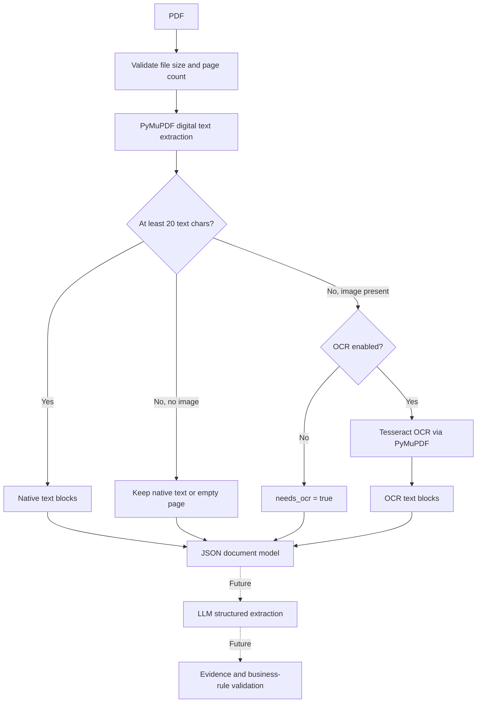

# Architecture (incremental)

The ingestion stage works without an LLM and preserves page-level evidence.

Both digital and OCR text blocks carry one-based page numbers, PDF-point
bounding boxes, and a `source` field (`pdf_text` or `ocr`).
Block IDs refer to a single ingestion, not a stable cross-version identifier.

## Current limitations

- OCR is opt-in (`--ocr`) and needs a separate Tesseract installation.
- OCR fallback is applied only to image-containing pages with **fewer than 20
  non-whitespace native text characters** (e.g., stray bullets). Pages with
  substantial digital text and additional scanned content are not fully covered.
- Text blocks are not a guarantee of correct reading order or table structure.
- No OCR confidence scores, document field extraction, validation, or RAG yet.
- `needs_ocr` remains true when OCR is disabled or yields no text on a page
  that meets the fallback criteria. Existing short native text is retained if
  OCR yields nothing.
