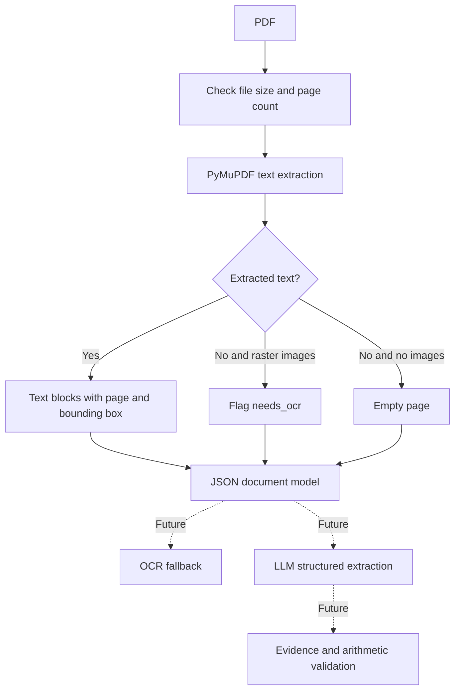

# Architecture (incremental)

The ingestion stage works without an LLM and preserves page-level evidence.

This first milestone **does not** perform OCR, reconstruct tables or reading order,
verify extracted facts, or use RAG. Text blocks preserve positions in PDF points;
source-block IDs refer to a single ingestion, not a stable cross-version identifier.

Planned next step: add OCR for scanned pages, preserving word-level evidence.
